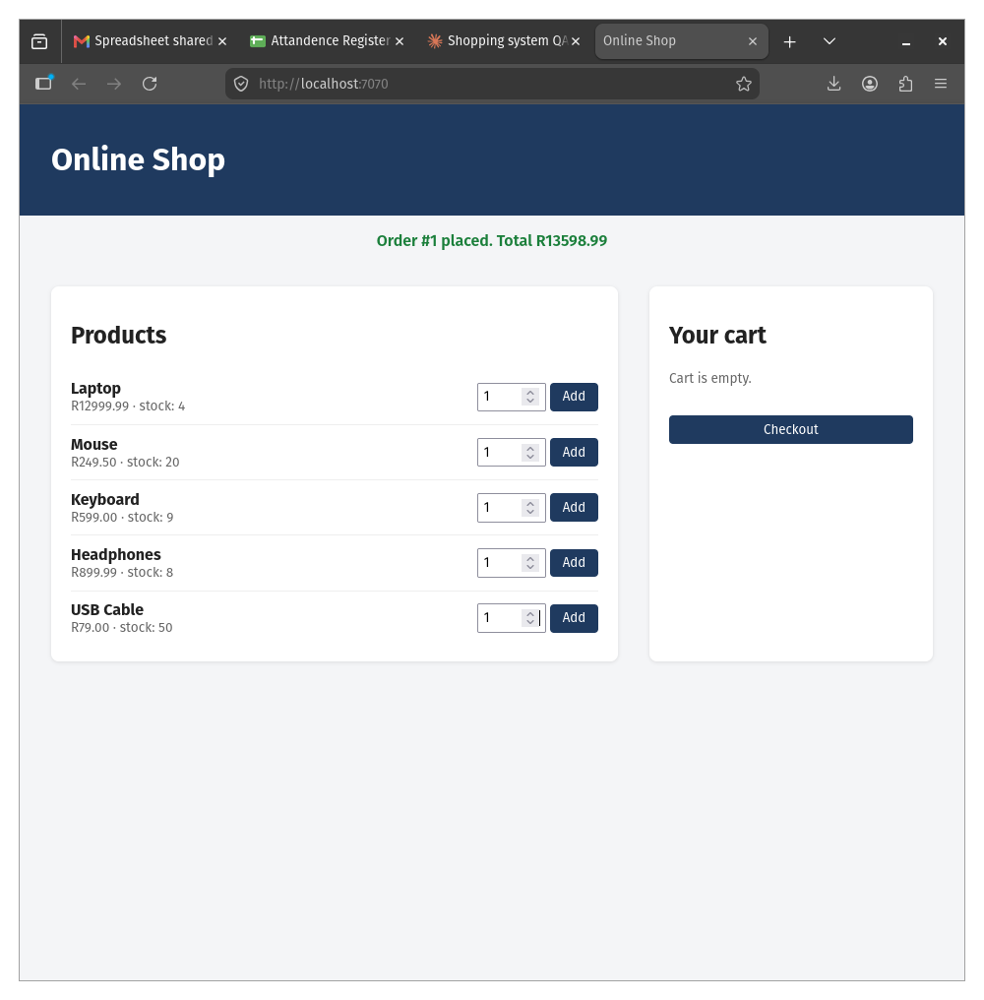

# shopping-system
A console-based online shopping system built in Java. Customers can browse a
product catalog, add items to a cart, and complete purchases via checkout.

## Run
    mvn -q compile
    java -cp target/classes com.shop.Main

## Test
    mvn test

## Web front end
    mvn -q compile exec:java
Then open http://localhost:7070

## Screenshot

## Verification code:
WTC-EN8YCRMQ
## Full website (branch: feature/full-website)
Features: sign up, log in/out, product search, per-user cart, simulated card or
cash-on-delivery payment, and order history.

    mvn -q compile exec:java
Then open http://localhost:7070

Demo card: 4242 4242 4242 4242, any future expiry (MM/YY), any 3-digit CVV.
No real payment is taken and only the last 4 digits are kept.
Data is held in memory, so accounts and orders reset when the server restarts.

## Tests
    mvn test
Covers cart, checkout, user registration/login, payment validation, and the REST API.

## C# version (NUnit)
    cd csharp
    dotnet test
Built test-first. See `git log` for the red, green and refactor commits.
